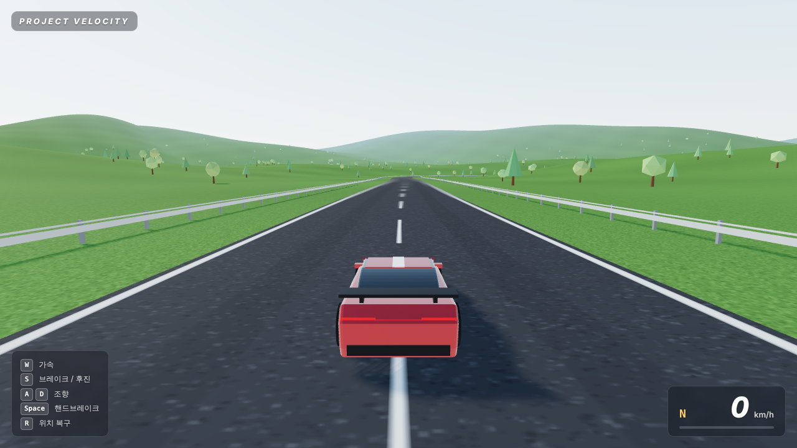

# Project Velocity

PC 웹브라우저용 3D 아케이드 레이싱 게임 (Three.js + Vite)

**현재 단계: 1단계 — 기본 3D 환경 및 차량 주행 시스템**



## 실행 방법

Node.js 18 이상이 필요합니다.

```bash
cd project-velocity
npm install
npm run dev        # 개발 서버 → http://localhost:5173
```

배포용 빌드:

```bash
npm run build      # dist/ 생성 (정적 호스팅 어디서나 실행 가능)
npm run preview    # 빌드 결과 미리보기
```

## 조작

| 키 | 동작 |
| --- | --- |
| W (↑) | 가속 |
| S (↓) | 브레이크 / 정지 후 후진 |
| A / D (← / →) | 좌회전 / 우회전 |
| Space | 핸드브레이크 (드리프트) |
| R | 출발 위치로 복구 (속도·방향 초기화) |

## 프로젝트 구조

```
project-velocity/
├─ index.html              # 캔버스 + HUD 마크업 (제목, 조작 안내, 속도계)
├─ vite.config.js
└─ src/
   ├─ main.js              # 진입점
   ├─ config.js            # ★ 주행·트랙·카메라·환경 설정값 (튜닝은 여기서)
   ├─ style.css            # 반투명 HUD 스타일
   ├─ core/
   │  ├─ Game.js           # 렌더러/씬, 고정 시간 간격 게임 루프, 차량 목록 관리
   │  └─ Input.js          # 키보드 상태 (동시 입력, 포커스 이탈 시 해제)
   ├─ vehicle/
   │  ├─ Vehicle.js        # 차량 상태(위치·방향·속도)와 아케이드 물리
   │  ├─ CarModel.js       # 기본 도형으로 만든 스포츠카 모델
   │  └─ PlayerController.js # 키보드 → 주행 입력(controls) 변환
   ├─ world/
   │  ├─ Track.js          # 닫힌 곡선 서킷, 도로/연석/가드레일 메시, 트랙 위치 질의
   │  ├─ Environment.js    # 하늘, 태양광·그림자, 지형, 나무
   │  └─ textures.js       # Canvas 절차적 텍스처 (아스팔트, 연석, 잔디)
   ├─ camera/
   │  └─ ChaseCamera.js    # 3인칭 추적 카메라 (지수 보간, 속도별 FOV)
   ├─ ui/
   │  └─ HUD.js            # 속도계 갱신
   └─ utils/
      └─ math.js
```

## 설계 메모

- **프레임 속도와 무관한 주행**: 렌더링은 `requestAnimationFrame`, 물리는 1/120초 고정 간격으로 누적 계산합니다. 렌더 시에는 직전/현재 물리 상태를 보간해 부드럽게 그립니다. 30/60/144fps에서 같은 입력으로 6초를 주행했을 때 위치 차이는 1cm 미만입니다.
- **주행 모델**: 속도를 차체 기준 전진/측면 성분으로 나눠 처리합니다. 선회량은 속도에 비례하므로 정지 상태에서는 회전하지 않고, 고속에서는 둔해집니다. 측면 미끄러짐은 접지력으로 감쇠되며, 핸드브레이크를 당기면 접지력이 낮아져 드리프트가 됩니다. 도로 밖(잔디)에서는 최대 72km/h로 감속되고, 가드레일에 부딪히면 튕겨나며 속도를 잃습니다.
- **확장 구조**: `Vehicle`은 입력 장치를 모르고 `{ throttle, brake, steer, handbrake }`만 받습니다. AI 차량은 같은 형태를 반환하는 컨트롤러를 만들어 `game.addVehicle(vehicle, controller, pose)`로 추가하면 됩니다. `Track.getInfo()`가 반환하는 중심선 인덱스·횡거리는 AI 경로 추종이나 진행도 계산에도 그대로 쓸 수 있습니다.
- 외부 이미지·모델·API는 사용하지 않습니다. 텍스처는 모두 Canvas로 생성하고, 하늘은 three.js에 포함된 `Sky` 셰이더를 씁니다.

## 주요 수치 (`src/config.js`)

| 항목 | 값 |
| --- | --- |
| 최고속도 | 약 220 km/h |
| 0→100 km/h | 약 2.4초 |
| 최대 후진 속도 | 약 43 km/h |
| 도로 밖 속도 제한 | 72 km/h |
| 서킷 길이 | 약 2.3 km (도로 폭 14m, 최소 코너 반경 약 36m) |
