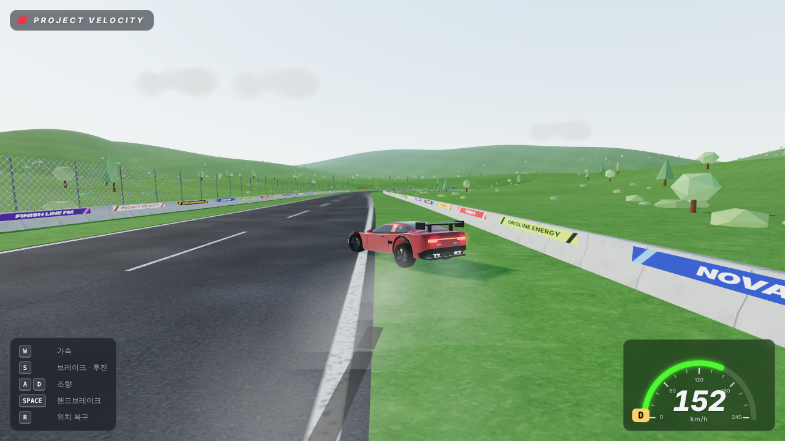

# Project Velocity

PC 웹브라우저용 3D 아케이드 레이싱 게임 (Three.js + Vite)

**진행 단계**
- 1단계: 기본 3D 환경 및 차량 주행 시스템 ✅
- 2단계: 차량 물리, 핸들링 및 드리프트 시스템 ✅
- 3단계: 3D 그래픽, 차량 모델 및 레이싱 환경 고도화 ✅
- 3.5단계: 안정화 (게임 상태·일시정지, 그래픽 품질 옵션, 안전 지점 복구, 디버그 패널) ✅




## 실행 방법

Node.js 18 이상이 필요합니다.

```bash
cd project-velocity
npm install
npm run dev        # 개발 서버 → http://localhost:5173
```

배포용 빌드:

```bash
npm run build      # dist/ 생성 (정적 호스팅 어디서나 실행 가능)
npm run preview    # 빌드 결과 미리보기
```

## 조작

| 키 | 동작 |
| --- | --- |
| W (↑) | 가속 |
| S (↓) | 브레이크 / 정지 후 계속 누르면 후진 (0.25초 대기) |
| A / D (← / →) | 좌회전 / 우회전 |
| Space | 핸드브레이크 (주행 중 조향과 함께 → 드리프트, 반대 조향으로 카운터스티어) |
| R | 최근 안전 지점으로 복구 (트랙 방향 정렬, 속도·회전 초기화 — 없으면 출발 위치) |
| ESC | 일시정지 / 재개 (창 포커스를 잃으면 자동 일시정지) |
| Enter | 시작 화면에서 게임 시작, 일시정지 중 재개 |
| F3 | 개발자 디버그 패널 표시/숨김 |

## 프로젝트 구조

```
project-velocity/
├─ index.html              # 캔버스 + HUD 마크업 (제목, 조작 안내, 속도계)
├─ vite.config.js
└─ src/
   ├─ main.js              # 진입점
   ├─ config.js            # ★ 주행·외형(CAR_APPEARANCE)·렌더·트랙·카메라·환경 설정값
   ├─ style.css            # 반투명 HUD 스타일
   ├─ core/
   │  ├─ Game.js           # 렌더러/씬, 상태별 게임 루프, 차량 목록, 복구, 디버그 정보, 리소스 해제
   │  ├─ GameState.js      # 상태 머신 (title / playing / paused / error)
   │  ├─ QualityManager.js # 그래픽 품질 적용 (재생성 없이 설정만 변경, 선택값 저장)
   │  ├─ SafePointTracker.js # 차량별 안전 지점 기록 → R 키 복구 위치
   │  └─ Input.js          # 키보드 상태 (동시 입력, 상태 전환 시 초기화)
   ├─ vehicle/
   │  ├─ Vehicle.js        # 차량 상태와 물리 (타이어 슬립 모델, 드리프트, 가드레일 충돌, 차체 움직임)
   │  ├─ carBody.js        # 스포츠카 차체 곡면(로프트) 절차적 생성
   │  ├─ CarModel.js       # 차체 + 라이트·휠·미러·윙·배기구 조립, 라이트/바퀴 애니메이션
   │  └─ PlayerController.js # 키보드 → 주행 입력(controls) 변환
   ├─ world/
   │  ├─ Track.js          # 닫힌 곡선 서킷, 레이아웃 분석(연석·직선·코너), 도로·결승선, 위치 질의
   │  ├─ Barriers.js       # 가드레일·콘크리트벽·타이어벽·펜스·경고 표지 (충돌선과 정렬)
   │  ├─ Facilities.js     # 관중석·피트 빌딩·출발 갠트리·광고판 (병합 메시)
   │  ├─ geometryUtils.js  # 병합·인스턴싱 헬퍼
   │  ├─ Environment.js    # 하늘·구름, 태양광·그림자, 지형, 나무·관목
   │  └─ textures.js       # Canvas 절차적 텍스처 (아스팔트, 잔디, 광고·표지판 아틀라스 등)
   ├─ effects/
   │  ├─ DriftEffects.js   # 차량 미끄러짐 상태 → 뒷바퀴 연기·스키드 마크
   │  ├─ ExhaustEffects.js # 가속 시 옅은 배기 연기 (별도 풀, 80개 상한)
   │  ├─ TireSmoke.js      # 연기 파티클 (고정 크기 풀, Points 1 드로우콜)
   │  └─ SkidMarks.js      # 스키드 마크 (링 버퍼, 상한 초과 시 오래된 것부터 덮어씀)
   ├─ camera/
   │  └─ ChaseCamera.js    # 3인칭 추적 카메라 (지수 보간, 속도별 FOV)
   ├─ ui/
   │  ├─ HUD.js            # 속도계
   │  ├─ Menus.js          # 시작·일시정지·오류 화면, 품질 선택
   │  └─ DebugPanel.js     # F3 개발자 패널
   └─ utils/
      └─ math.js
```

## 3.5단계 안정화

- **게임 상태**: `GameState`가 시작 화면, 주행, 일시정지, 오류를 하나의 상태로 관리합니다. 물리는 주행 상태에서만 진행됩니다.
  - 상태가 바뀔 때마다 눌려 있던 키와 누적된 프레임 시간을 비웁니다. 그래서 재개 직후 차가 튀거나 이전 입력이 남지 않습니다.
  - 창 포커스를 잃거나 탭이 숨겨지면 자동으로 일시정지합니다.
- **그래픽 품질 (낮음 / 보통 / 높음)**: 렌더 해상도, 그림자 해상도와 범위, 나무·관목 표시 거리, 식생·시설물 그림자, 관중 수, 연기 양, HUD 배경 흐림을 조절합니다.
  - 식생은 트랙에서 가까운 순서로 정렬해 두어서, 표시 거리를 바꿀 때 오브젝트를 다시 만들지 않습니다.
  - 선택한 품질은 브라우저에 저장됩니다. 값은 `QUALITY_PRESETS`에서 정합니다.
- **R 복구**: 다음 조건을 모두 만족할 때 0.25초마다 현재 트랙 지점을 안전 지점으로 기록합니다.
  - 도로 위, 중앙에서 5m 이내, 트랙 방향으로 주행 중, 슬립각 17° 미만, 최근 1초간 벽 충돌 없음.
  - 복구 위치는 그 지점에서 6m 뒤의 도로 중앙(방호벽에서 약 13m)이고, 차체는 트랙 방향으로 맞춥니다.
- **벽 끼임 방지**: 벽을 향해 가속 페달을 밟고 있으면, 벽에 닿은 모서리를 축으로 차체를 돌릴 수 있습니다.
  - 조향하면 그 방향으로, 조향이 없으면 벽면과 나란해지는 방향으로 돌아 빠져나옵니다.
- **F3 디버그 패널**: FPS·프레임 시간·draw call, 속도(종/횡), 조향각, 페달, 드리프트, 앞뒤 타이어 슬립·접지 사용률, 노면, 최근 충돌, 복구 지점, 게임 상태를 보여 줍니다.
- **안정성**:
  - WebGL 2를 쓸 수 없으면 해결 방법을 안내합니다.
  - 그래픽 장치가 끊기면 안내 화면을 띄우고, 복구되면 일시정지 상태로 돌아갑니다.
  - `Game.dispose()`가 리소스와 이벤트를 해제합니다. 개발 서버 핫 리로드 때도 호출됩니다.

## 3단계 그래픽

- **차량 모델**: 길이 방향 단면을 이어 붙인 로프트 곡면으로 차체를 절차적으로 생성합니다.
  - 펜더가 솟은 낮고 넓은 차체에 보닛, 루프, 패스트백 라인을 표현했습니다.
  - 휠하우스, 앞뒤 범퍼, 그릴, 스플리터, LED 헤드라이트, 풀폭 테일램프, 후진등, 사이드미러, 도어 라인, 디퓨저, 쿼드 배기구, 리어 윙을 갖췄습니다.
  - 휠은 5트윈 스포크에 브레이크 디스크와 캘리퍼가 있습니다.
  - 바퀴 위치는 물리 차축(앞 1.38m, 뒤 1.32m)과 정확히 일치합니다. 색상과 재질은 `CAR_APPEARANCE`에서 바꿉니다.
- **애니메이션과 라이트**: 바퀴는 실제 속도로 회전하고(후진 시 역회전, 정지 시 멈춤), 앞바퀴는 실제 조향각을 따릅니다.
  - 차체는 무게중심 높이에서 기울고, 바퀴는 지면에 고정됩니다.
  - 브레이크를 밟으면 테일램프가 밝아지고, R 기어에서는 후진등이 켜집니다. 가속할 때는 옅은 배기 연기가 납니다.
- **트랙**: 아스팔트에 범프맵과 저주파 정점 음영을 더해 반복감을 줄였습니다. 연석은 살짝 솟아 있고, 결승선 체커와 그리드 박스를 그렸습니다.
  - 방호벽은 구간별로 다릅니다: 메인 직선은 콘크리트벽과 광고, 급코너 바깥은 타이어벽과 펜스, 나머지는 가드레일입니다.
  - 쉐브론 경고판, 150/100/50 거리 표지, 코너 번호판(T1~T8)을 세웠습니다.
- **판정 일치**: 모든 방호벽의 트랙 쪽 면은 충돌선(`railOffset + 0.05`) 바깥에 있습니다. 연석 위는 노면 판정에서도 도로로 인정합니다.
- **경기장**: 관중석 4동과 관중 약 1,300명, 피트 빌딩, 컨트롤 타워, 피트 에이프런, 출발 갠트리, 코너 광고판을 배치했습니다. 광고는 모두 가상 브랜드입니다.
- **자연 환경**: 나무 3종(크기 다양), 관목, 언덕과 원경 산, 구름을 두었습니다. 잔디는 2중 샘플링으로 반복 패턴을 완화했습니다.
- **렌더링**: 하늘 기반 환경 반사(PBR)와 ACES 톤매핑을 쓰고, 그림자는 차량 주변 140m로 제한했습니다. 후처리는 쓰지 않았습니다.
- **성능**: 반복 오브젝트는 InstancedMesh로, 시설물과 차량 부품은 재질별 병합 메시로 그립니다. 파티클에는 상한을 두었고, 픽셀 비율은 최대 1.75입니다. 출발 지점 기준 draw call은 89입니다.

## 2단계 주행 물리

간소화한 2륜(자전거) 차량 모델을 아케이드에 맞게 조정했습니다.

- **상태 분리**: 위치, 차체 방향(heading), 실제 속도 벡터, 요 각속도를 각각 관리합니다. 매 스텝 속도를 차체 기준 종/횡 성분으로 나눠 계산합니다.
- **종방향**: 가속력은 속도가 오를수록 줄어듭니다. 브레이크를 밟으면 정지할 때까지 제동하고, 정지 후 0.25초 이상 계속 밟고 있어야 후진(R) 기어로 바뀝니다. 후진 중 W도 같은 방식으로 동작합니다.
- **조향**: 저속에서는 최대 34°까지 꺾입니다. 고속에서는 접지 한계에 맞춰 조향각이 자동으로 제한됩니다(200km/h에서 약 3°). 입력은 보간되어 서서히 꺾이고 서서히 돌아옵니다. 후진할 때는 조향각이 60%로 줄어듭니다.
- **타이어**: 앞/뒤 바퀴의 슬립각으로 횡력을 계산합니다. 슬립각이 약 8°까지는 접지력이 선형으로 늘고, 넘어서면 미끄럼 마찰로 떨어집니다. 회전 관성이 있어 요 각속도가 서서히 변합니다. 6km/h 미만에서는 기구학 모델로 전환되므로 정지 상태에서는 회전하지 않습니다.
- **드리프트**: 핸드브레이크를 당기면 뒷바퀴 접지력이 30%로 떨어져 뒤가 미끄러집니다. 정지·저속에서는 효과가 없습니다. 놓으면 접지력이 약 0.6초에 걸쳐 회복됩니다. 미끄러지는 쪽으로 조향하면 조향각 제한이 풀려 카운터스티어가 가능합니다.
- **안정화**: 요 각속도 상한, 슬립각 복원 토크, 슬립각 절대 상한(65°)을 둡니다. 핸드브레이크를 놓으면 속력은 유지한 채 진행 방향을 차체 쪽으로 정렬합니다. 무한 회전이나 조작 불능 상태가 생기지 않습니다.
- **충돌**: 차체 모서리 4개와 측면 중앙 2개를 가드레일 검사점으로 씁니다. 0.5m 간격 이동 구간 검사로 고속에서도 관통하지 않습니다. 침투하면 위치를 보정하고, 충격량(반발·마찰·회전)과 진행 각도에 따른 속도 손실을 적용합니다. 정면 충돌은 크게 감속하고, 비스듬히 부딪히면 벽을 타고 미끄러집니다.
- **차체 움직임**: 시각 전용 스프링-댐퍼로 가속 시 앞이 들리고, 제동 시 숙이고, 코너에서 바깥쪽으로 기웁니다. 물리 좌표와 충돌에는 영향을 주지 않습니다. 앞바퀴 조향각은 실제 조향 상태를, 바퀴 회전은 실제 속도를 따릅니다. 핸드브레이크를 당기면 뒷바퀴가 멈춥니다.
- **효과**: 뒷바퀴 슬립각이 10°를 넘으면 연기와 스키드 마크가 생깁니다(일반 코너링에서는 나오지 않음). 스키드 마크는 아스팔트 위에만 남고, 잔디에서는 연기만 약하게 납니다. 연기 260개와 스키드 마크 1600조각에 상한을 두고 재사용합니다.
- **카메라**: 드리프트할 때는 차체 방향과 실제 진행 방향을 섞어 따라가므로 차가 화면 중앙에 머뭅니다. 정지·저속·후진에서는 차체 방향만 따라갑니다. 급회전할 때는 회전이 지연되되, 지연 각도에 상한이 있습니다.

## 설계 메모

- **프레임 속도와 무관한 주행**: 렌더링은 `requestAnimationFrame`, 물리는 1/120초 고정 간격으로 누적 계산합니다. 렌더 시에는 직전/현재 물리 상태를 보간해 부드럽게 그립니다. 30/60/144fps에서 같은 입력으로 6초를 주행했을 때 위치 차이는 1cm 미만입니다.
- **주행 모델**: 속도를 차체 기준 전진/측면 성분으로 나눠 처리합니다. 선회량은 속도에 비례하므로 정지 상태에서는 회전하지 않고, 고속에서는 둔해집니다. 측면 미끄러짐은 접지력으로 감쇠되며, 핸드브레이크를 당기면 접지력이 낮아져 드리프트가 됩니다. 도로 밖(잔디)에서는 최대 72km/h로 감속되고, 가드레일에 부딪히면 튕겨나며 속도를 잃습니다.
- **확장 구조**: `Vehicle`은 입력 장치를 모르고 `{ throttle, brake, steer, handbrake }`만 받습니다. AI 차량은 같은 형태를 반환하는 컨트롤러를 만들어 `game.addVehicle(vehicle, controller, pose)`로 추가하면 됩니다. `Track.getInfo()`가 반환하는 중심선 인덱스·횡거리는 AI 경로 추종이나 진행도 계산에도 그대로 쓸 수 있습니다.
- 외부 이미지·모델·API는 사용하지 않습니다. 텍스처는 모두 Canvas로 생성하고, 하늘은 three.js에 포함된 `Sky` 셰이더를 씁니다.

## 주요 수치 (`src/config.js`)

| 항목 | 값 |
| --- | --- |
| 최고속도 | 약 220 km/h |
| 0→100 km/h | 약 2.4초 (0→200 약 6.5초) |
| 제동 100→0 km/h | 약 1.1초 / 15m |
| 최대 횡가속도 | 약 2.1g (아케이드 수준의 높은 접지력) |
| 최대 후진 속도 | 약 43 km/h |
| 도로 밖 속도 제한 | 72 km/h |
| 서킷 길이 | 약 2.3 km (도로 폭 14m, 최소 코너 반경 약 36m) |
